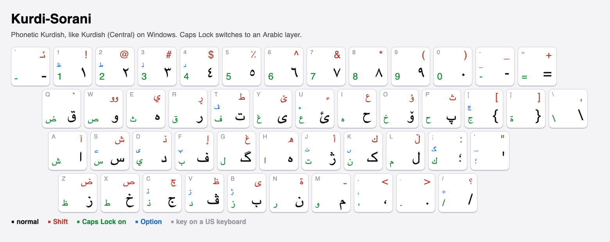
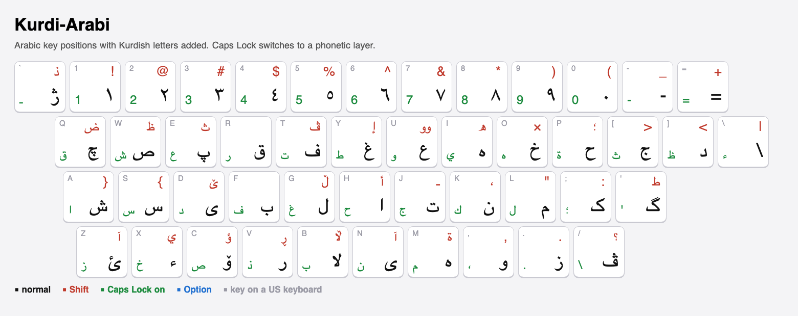

# ⌨️ کیبۆردی کوردی بۆ macOS

🌐 [English](README.md) · **کوردی**

**کیبۆردی کوردی (سۆرانی) بۆ ماک، نوێکراوەتەوە و چاککراوە.**

## ✨ چی چاککراوە

- ↔️ **ئاراستەی نووسین لە ڕاستەوە بۆ چەپ** ئێستا لە بەرنامەکاندا بە شێوازی راست کار دەکات، بەتایبەتی لە **Microsoft Word**
- ⌘ **کورتبڕەکانی (شۆرتکەت) سیستەم کار دەکەن** کاتێک ئەم تەختەکلیلانە چالاکن
- 🟢 **ئایکۆنی ئاڵای کوردستان** کە لەگەڵ شێوازی macOS دەگونجێت

## ⌨️⌨️ کیبۆردەکان

یەک فایل، `Kurdi.bundle`، کە دوو کیبۆردی تێدایە. هەردووکیان وەک کوردیی ناوەندی (`ckb`) ناسێنراون و ئاڵای کوردستان پیشان دەدەن.

### Kurdi-Sorani

کوردی، وەک *Kurdish (Central)* لە ویندۆز.

### Kurdi-Arabi

تەختەکلیلی عەرەبیی ویندۆز لەگەڵ پیتە کوردییەکان.

لە هەردوو وێنەکەدا: ڕەش کلیلی ئاساییە، سوور لەگەڵ Shift، سەوز کاتێک Caps Lock داگیرساوە، شین لەگەڵ Option.

> لە macOS بۆ ئەو کیبۆردانەی کە هی Apple نین، شێوازی ریزبوونی پیتەکان نیشان نادات، بۆیە سوود لە وێنەکانی سەرەوە وەربگرە. دوای چالاککردنی کیبۆردەکە دەتوانیت لە لیستی تەختەکلیل لە شریتی سەرەوە **Show Keyboard Viewer** هەڵبژێریت.

## 🚀 دامەزراندن

1. **[⬇️ کلیک بکە بۆ داگرتن](https://github.com/harunabubakir/kurdi-keyboard-macos/releases/latest/download/Kurdi-Keyboard-Layouts.zip)**ـی دوایین <code dir="ltr">Kurdi-Keyboard-Layouts.zip</code>، پاشان بیکەرەوە.
2. `Kurdi.bundle` کۆپی بکە بۆ: <code dir="ltr">~/Library/Keyboard Layouts/</code>

   لە Finder: **Go → Go to Folder…** (⇧⌘G)، ئەو ڕێڕەوەی سەرەوە بلکێنە و فایلەکەی تێ بخە.
3. لە هەژمارەکەت بچۆ دەرەوە (Log Out) و دووبارە بچۆرەوە ژوورەوە.
4. **System Settings → Keyboard → Input Sources → Edit → +** بکەرەوە، **Kurdi-Sorani** و **Kurdi-Arabi** بدۆزەرەوە (لە ژێر *Kurdish* یان *Others*) و زیادیان بکە.

## 🗑️ سڕینەوە

`Kurdi.bundle` لە <code dir="ltr">~/Library/Keyboard Layouts/</code> بسڕەوە، پاشان بچۆ دەرەوە و دووبارە بچۆرەوە ژوورەوە.

## 🙏 سوپاس

لەسەر بنەمای کیبۆردی یەکگرتووی کوردی دروستکراوە کە فەرمانگەی تەکنەلۆجیای زانیاریی حکومەتی هەرێمی کوردستان بڵاوی کردووەتەوە: <http://unicode.ekrg.org/download.html>

