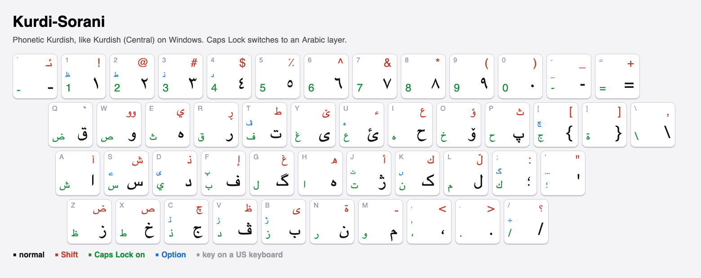
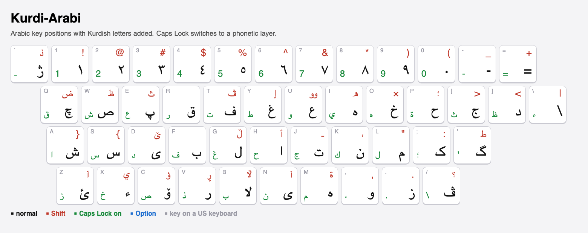

# ⌨️ Kurdi Keyboard Layouts for macOS

🌐 **English** · [کوردی](README.ckb.md)

**Kurdish (Sorani) keyboard layouts for Mac, updated and fixed by [Haroon](https://github.com/harunabubakir).**

## ✨ What's fixed

- ↔️ **Right-to-left writing direction** now works in apps, especially **Microsoft Word**
- ⌘ **System shortcuts work** while these layouts are active
- 🟢 **Rounded flag icon** that matches the macOS menu bar style

## 📦 Layouts

One bundle, `Kurdi.bundle`, with two layouts. Both are tagged as Central Kurdish (`ckb`) and show the Kurdistan flag.

### Kurdi-Sorani

Phonetic Kurdish, like *Kurdish (Central)* on Windows.



### Kurdi-Arabi

The Arabic Windows layout with Kurdish letters added.



In both pictures: black is the normal key, red is Shift, green is with Caps Lock on, blue is Option.

> macOS shows a privacy warning instead of a keyboard preview for keyboards that don't come from Apple, so use the pictures above. Once a layout is active you can also choose **Show Keyboard Viewer** from the input menu in the menu bar.

## 🚀 Install

1. Download the zip from the [latest release](../../releases/latest) and unzip it.
2. Copy `Kurdi.bundle` to:

   ```
   ~/Library/Keyboard Layouts/
   ```

   In Finder: **Go → Go to Folder…** (⇧⌘G), paste the path above, and drop the file in.
3. Log out and log back in.
4. Open **System Settings → Keyboard → Input Sources → Edit → +**, find **Kurdi-Sorani** and **Kurdi-Arabi** (under *Kurdish* or *Others*) and add them.

## 🗑️ Uninstall

Delete `Kurdi.bundle` from `~/Library/Keyboard Layouts/`, then log out and back in.

## 🙏 Credits

Based on the unified Kurdish keyboard published by the Kurdistan Regional Government Department of Information Technology: <http://unicode.ekrg.org/download.html>

Claude Code
